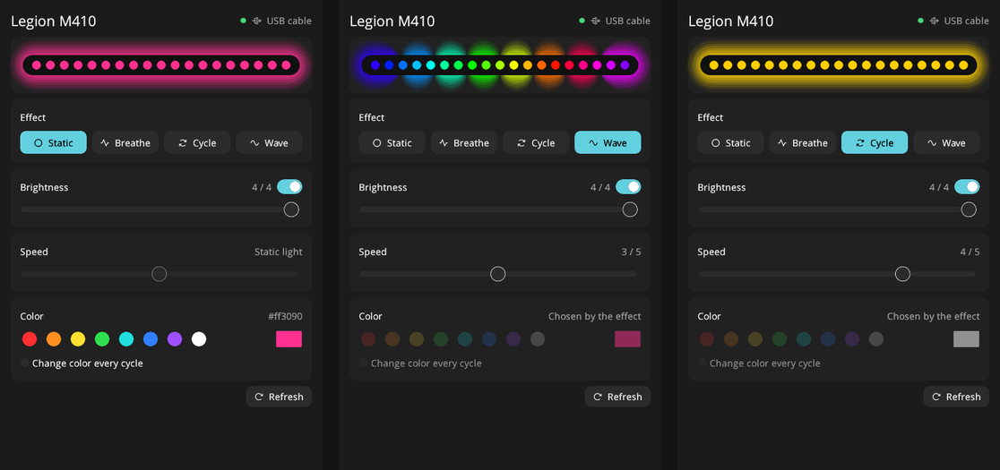
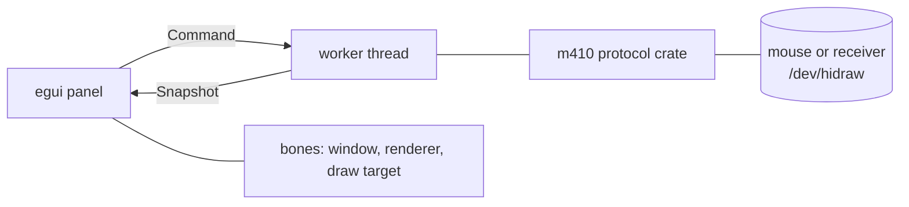

# Legion M410 RGB

[](https://ai-level.dev/level-4)
[](LICENSE)
[](https://github.com/an-dr/bones)


Lighting control for the **Lenovo Legion M410** mouse on Linux, over its USB cable or its wireless receiver.

Lenovo's software is Windows-only and [OpenRGB](https://openrgb.org) does not support this mouse, so this app talks to it directly. It is a native [bones](https://github.com/an-dr/bones) application with an [egui](https://www.egui.rs) interface that takes its font, light or dark mode and accent color from your desktop.

<p align="center"></p>

## What it does

- **A live preview.** The strip at the top glows in the effect, color and brightness you have set, and breathes, cycles or ripples the way the real light does.
- **Four effects:** static, breathe, color cycle and rainbow wave.
- **Brightness** off or in four steps, and **speed** in five, on sliders you drag.
- **Any color:** eight swatches, a full color picker for everything else, or random.
- **Wired or wireless.** With both connected it uses the cable.
- **A sleeping mouse is fine.** A wireless mouse sleeps about 30 s after you stop moving it. Change something then, and the app holds the change and applies it the moment the mouse wakes.
- **Plug and unplug freely.** The app notices on its own; no restart.
- **Looks at home.** The theme follows your desktop (COSMIC, GNOME or KDE): its font, its accent, light or dark.
- **No daemon.** Settings are stored on the mouse and survive power cycles and other computers.



## Install

You need Rust, [`just`](https://just.systems), CMake and a C compiler, plus the libraries the engine links. On Debian, Ubuntu and Pop!_OS:

```sh
sudo apt install pkg-config libasound2-dev libpulse-dev libx11-dev libxext-dev libxrandr-dev \
  libxcursor-dev libxfixes-dev libxi-dev libxss-dev libxtst-dev libxkbcommon-dev libwayland-dev \
  wayland-protocols libdecor-0-dev libegl1-mesa-dev libgl1-mesa-dev libgles2-mesa-dev libdrm-dev \
  libgbm-dev libdbus-1-dev libudev-dev
```

Then, from a clone of this repository:

```sh
just install-udev   # once per machine: lets your user open the mouse (needs sudo)
just install        # builds, then installs to ~/.local
```

The first build compiles SDL3 from source, which takes several minutes and a few gigabytes of disk. Later builds take seconds. Replug the mouse or its receiver after installing the udev rule, then run `legion-m410-linux-rgb` or open **Legion M410 RGB** from your launcher.

`just uninstall` removes it again.

## Using it

Controls that do nothing right now are dimmed instead of hidden, so the layout never jumps: a static light has no speed, and cycle and wave choose their own colors.

| Control | Does |
| --- | --- |
| Effect buttons | Pick the effect |
| Brightness switch and slider | Switch the light off and on at the brightness it had, or drag to a step. The change is written when you let go |
| Speed slider | Drag to a step, for effects that move |
| Swatches and the color button | Pick a color; the button opens a full picker, and the color is written once it stops changing |
| Change color every cycle | A new color each cycle |
| Refresh | Read the mouse again |

The line under the controls says what to do when something is wrong: move the mouse if it is asleep, plug it in if it is not found, install the udev rule if there is no permission. The window can be resized: the layout is tested at widths from 400 to 1600 px.

## How it works



- **One native process.** The interface is an egui module of this app's own, drawn through the engine's public `draw-target` service and fed raw window events. It is the arrangement [cross-wall](https://github.com/an-dr/cross-wall) uses; the module and the theme are adapted from there.
- **A worker thread** does all the device I/O. A sleeping wireless mouse takes seconds to give up, and an interface that waited would freeze. Only the newest of a burst of changes is written, so dragging a slider costs one flash write, not many.
- **`Controller`** is what the worker runs: a small state machine over a `Mouse` trait, so sleeping, waking, hot-plugging and giving up are all unit-tested without hardware.
- **The `m410` crate** is the protocol: [docs/protocol.md](docs/protocol.md) has what is known about it.

## Project layout

| Path | What |
| --- | --- |
| [`app/src/gui/`](app/src/gui) | The interface: the egui module, the desktop theme, and the panel |
| [`app/src/controller.rs`](app/src/controller.rs) | What the worker decides: commands, waiting, polling, giving up |
| [`app/src/backend.rs`](app/src/backend.rs) | The worker thread behind two channels |
| [`app/src/mouse.rs`](app/src/mouse.rs) | The `Mouse` trait and the real USB mouse |
| [`crates/m410/`](crates/m410) | The protocol over Linux hidraw |
| [`res/`](res) | The udev rule and the desktop entry |

## Development

```sh
just run    # run from the source tree
just test   # unit tests, which need no mouse
```

The tests cover the controller, the worker thread, the theme, and the panel itself: it is run headlessly through egui with synthetic pointer events, pressing the controls where the panel says they are, at several window widths.

The screenshots in `docs/` are the app's own output: run it with `BONES_OFFSCREEN=1 BONES_DEVTOOLS_PORT=8642` and fetch `http://localhost:8642/screenshot`. Setting `BONES_DEVTOOLS_PORT` opens bones' devtools channel on `127.0.0.1`, which can publish messages, so leave it unset for everyday use.

## Limitations

- **The sleep timeout is fixed.** The mouse sleeps about 30 s after you stop moving it, and nothing in its configuration changes that.
- **Not native controls.** egui draws its own widgets in the desktop's colors and font, so it resembles the platform without being its real controls.
- **Only COSMIC has been seen on real hardware.** The GNOME and KDE looks are built and unit-tested, but not looked at.
- **Linux only,** and only the M410 (`17ef:6197` by cable, `17ef:6198` by receiver). DPI and button settings are left alone.

## AI

This project is developed openly with AI agents, at [AI Level 4](https://ai-level.dev/level-4).

## License

MIT, see [LICENSE](LICENSE). The egui module, theme and color helpers are adapted from [cross-wall](https://github.com/an-dr/cross-wall), also MIT.
