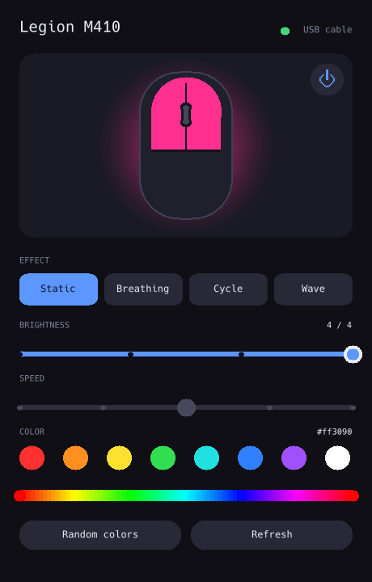
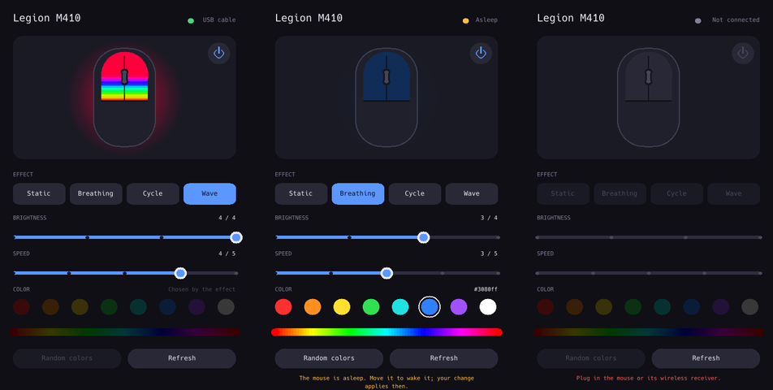
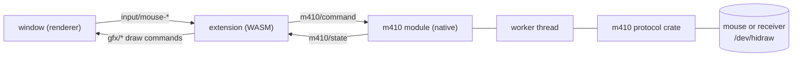

# Legion M410 RGB

[](https://ai-level.dev/level-4)
[](LICENSE)
[](https://github.com/an-dr/bones)


Lighting control for the **Lenovo Legion M410** mouse on Linux, over its USB cable or its wireless receiver.

Lenovo's software is Windows-only and [OpenRGB](https://openrgb.org) does not support this mouse, so this app talks to it directly. It is a [bones](https://github.com/an-dr/bones) application: a small native module owns the mouse, and the interface is a sandboxed WASM extension that draws itself.

<p align="center"></p>

## What it does

- **A live preview.** The mouse in the panel glows in the effect, color and brightness you have set, and breathes, cycles or ripples the way the real one does.
- **Four effects:** static, breathing, color cycle and rainbow wave.
- **Brightness** off or in four steps, and **speed** in five, on sliders you drag.
- **Any color:** eight swatches, a hue bar for everything else, or random.
- **Wired or wireless.** With both connected it uses the cable.
- **A sleeping mouse is fine.** A wireless mouse sleeps about 30 s after you stop moving it. Change something then, and the app holds the change and applies it the moment the mouse wakes.
- **Plug and unplug freely.** The app notices on its own; no restart.
- **No daemon.** Settings are stored on the mouse and survive power cycles and other computers.



## Install

You need Rust, [`just`](https://just.systems), CMake and a C compiler, plus the libraries the engine links. On Debian, Ubuntu and Pop!_OS:

```sh
sudo apt install pkg-config libasound2-dev libpulse-dev libx11-dev libxext-dev libxrandr-dev \
  libxcursor-dev libxfixes-dev libxi-dev libxss-dev libxtst-dev libxkbcommon-dev libwayland-dev \
  wayland-protocols libdecor-0-dev libegl1-mesa-dev libgl1-mesa-dev libgles2-mesa-dev libdrm-dev \
  libgbm-dev libdbus-1-dev libudev-dev
```

Then the bones tool, which builds the extension, and the WASM target it needs:

```sh
cargo install --git https://github.com/an-dr/bones --tag v4.0.0 bones-develop
rustup target add wasm32-wasip2
```

Then, from a clone of this repository:

```sh
just install-udev   # once per machine: lets your user open the mouse (needs sudo)
just install        # builds, then installs to ~/.local
```

The first build compiles SDL3 and wasmtime from source, which takes several minutes and a few gigabytes of disk. Later builds take seconds. Replug the mouse or its receiver after installing the udev rule, then run `legion-m410-linux-rgb` or open **Legion M410 RGB** from your launcher.

`just uninstall` removes it again.

## Using it

Everything on the panel works with the mouse pointer. Controls that do nothing right now are dimmed instead of hidden, so the layout never jumps: a static light has no speed, and cycle and wave choose their own colors.

| Control | Does |
| --- | --- |
| Power button, top right of the preview | Switch the lighting off and on without losing the other settings |
| Effect row | Pick the effect |
| Brightness and speed sliders | Click or drag to a step. The change is written when you let go |
| Swatches | Pick a ready-made color, which turns random colors off |
| Hue bar | Click or drag to any hue |
| Random colors | A new color each cycle |
| Refresh | Read the mouse again |

The line under the panel says what to do when something is wrong: move the mouse if it is asleep, plug it in if it is not found, install the udev rule if there is no permission.

## How it works



- **The extension** has no way to reach the hardware. It draws the whole interface itself with the engine's shapes and text, reads the mouse pointer, and turns clicks into `m410/command` messages. Its logic is the pure [`m410-panel`](crates/panel) crate, so layout, hit-testing, dragging and the preview animation are unit-tested without a window.
- **The module** owns the mouse. It receives those commands and publishes `m410/state` after every change.
- **A worker thread** does all the device I/O. A sleeping wireless mouse takes seconds to give up, and a module that waited would stall every frame. Only the newest of a burst of changes is written, so dragging a slider costs one flash write, not many.
- **The `m410` crate** is the protocol: [docs/protocol.md](docs/protocol.md) has what is known about it.

## Project layout

| Path | What |
| --- | --- |
| [`app/`](app) | The executable: bones with the native module composed in. `Controller` is the testable logic |
| [`extension/`](extension) | The panel as a bones extension, built for `wasm32-wasip2`: glue between the bus and `m410-panel` |
| [`crates/panel/`](crates/panel) | The panel as pure data: layout, interaction, animation and draw commands |
| [`crates/messages/`](crates/messages) | The vocabulary between the module and the extension, shared by both sides of the sandbox |
| [`crates/m410/`](crates/m410) | The protocol over Linux hidraw |
| [`checks/`](checks) | Runs the real extension and module together against a fake mouse |
| [`res/`](res) | The udev rule and the desktop entry |

## Development

```sh
bones-develop dev   # run from the source tree; the extension rebuilds and reloads on every save
cargo test          # unit tests, and the checks that run the whole stack against a fake mouse
```

`cargo test` covers the message codec, the panel (every control, dragging, scaling, the animation), the controller (sleeping mice, hot-plugging, bursts of changes, giving up) and the whole path from a click to a write. None of it needs a mouse.

The screenshots in `docs/` are the app's own output: run it with `BONES_OFFSCREEN=1 BONES_DEVTOOLS_PORT=8642` and fetch `http://localhost:8642/screenshot`. Setting `BONES_DEVTOOLS_PORT` opens bones' devtools channel on `127.0.0.1`, which can publish messages, including commands to the mouse, so leave it unset for everyday use.

## Limitations

- **The sleep timeout is fixed.** The mouse sleeps about 30 s after you stop moving it, and nothing in its configuration changes that.
- **The window size is re-asserted.** bones windows are always resizable, and the panel is a fixed layout, so it asks for its own size every 1.5 s. That keeps clicks lined up with what is drawn.
- **No transparency.** The renderer draws shapes opaque, so the preview's glow is built from pre-blended rings over the card's solid color.
- **Mouse pointer only.** There is no keyboard control yet.
- **Linux only,** and only the M410 (`17ef:6197` by cable, `17ef:6198` by receiver). DPI and button settings are left alone.

## AI

This project is developed openly with AI agents, at [AI Level 4](https://ai-level.dev/level-4).

## License

MIT, see [LICENSE](LICENSE).
